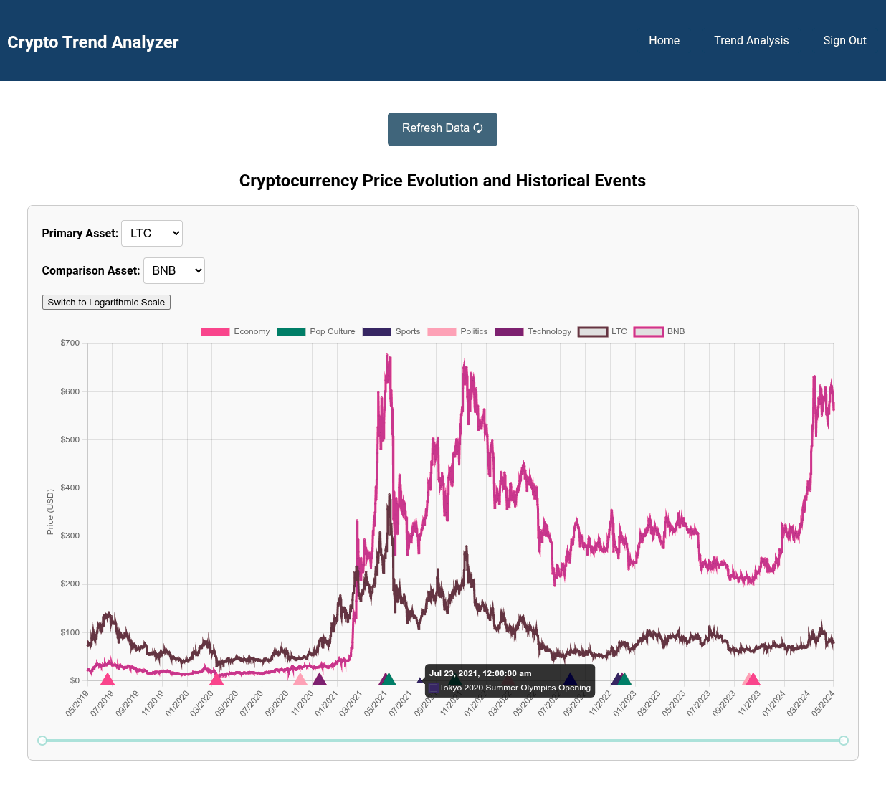
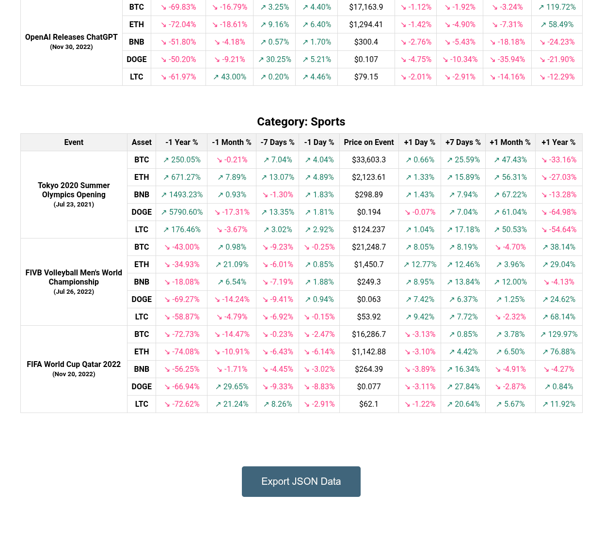
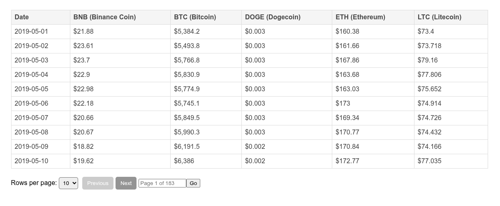
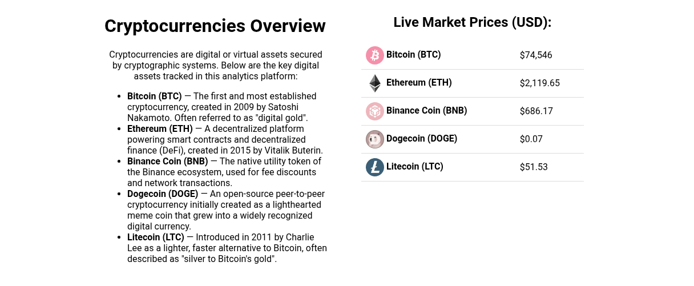
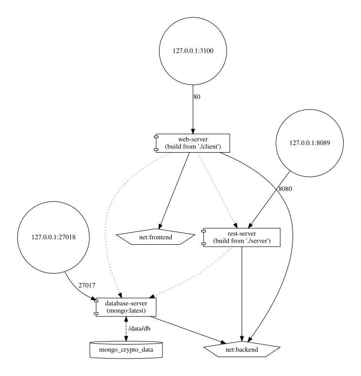

# Crypto Trend Analyzer

A web application for analyzing how global macroeconomic, political, technological, and cultural events correlate with cryptocurrency prices over time.

The project uses historical price data alongside an event catalog to calculate price changes across multiple timeframes (1 day, 7 days, 1 month, and 1 year before and after each event).

---

## Screenshots

| Price & Events Timeline Chart | Event Impact Matrix |
|:---:|:---:|
|  |  |

| Historical Price Table | Live CoinGecko Feed |
|:---:|:---:|
|  |  |

---

## Features

- **Event-Driven Charting:** Interactive price chart comparing two assets with event markers overlaid on the timeline (linear and logarithmic scales).
- **Multi-Horizon Impact Analysis:** Pre- and post-event percentage change tables for Bitcoin, Ethereum, Binance Coin, Dogecoin, and Litecoin.
- **Live Market Data:** Real-time crypto quotes pulled directly from the CoinGecko public API on the home page.
- **JSON Data Export:** Export the calculated event influence matrices to a `.json` file for further analysis.
- **Authentication:** JWT-based user authentication with BCrypt password hashing.
- **Automatic Database Seeding:** The backend automatically imports historical data and provisions a demo user account on startup.

---

## Tech Stack

- **Backend:** C# / .NET 8 (ASP.NET Core Web API), MongoDB C# Driver, JWT Bearer, BCrypt.Net
- **Frontend:** React 18, Vite, React Router, Chart.js, Axios
- **Database:** MongoDB
- **Testing:** xUnit, Moq (.NET), Vitest, React Testing Library (React)
- **Deployment:** Docker, Docker Compose, Nginx

---

## Quick Start (Docker)

### Requirements
- [Docker Engine & Docker Compose](https://docs.docker.com/get-docker/)

### 1. Clone the repository
```bash
git clone https://github.com/musmike/crypto-trend-analyzer.git
cd crypto-trend-analyzer
```

### 2. Configure environment variables
Copy the example environment file:
```bash
cp .env.example .env
```

### 3. Build and start the services
```bash
docker compose up -d --build
```

### 4. Open in browser
Navigate to [http://localhost:3100](http://localhost:3100).

### Demo Credentials
The database is automatically seeded on startup. You can sign in using the default demo credentials configured in `.env`:
- **Username:** `demo`
- **Password:** `demo123`

---

## Running Unit Tests

### Backend Tests (.NET xUnit)
```bash
dotnet test server.Tests/server.Tests.csproj
```

### Frontend Tests (Vitest & React Testing Library)
```bash
cd client
npm install
npm test
```

---

## Architecture & Ports

| Service | Technology | Port (Host) |
|---|---|---|
| Frontend (`client`) | React + Nginx | `http://localhost:3100` |
| Backend API (`server`) | .NET 8 Web API | `http://localhost:8089` |
| Database (`db`) | MongoDB | `localhost:27018` |



---

## Authors
- **Michał Muzyka** — [GitHub](https://github.com/musmike)
- **Mateusz Niedźwiedź** – [GitHub](https://github.com/JonaszGoldbaumm)